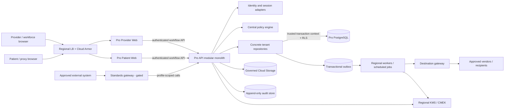

# Flowstate Pro system design

**Status:** SPECIFIED PLANNING TARGET — Gate G0 remains `BLOCKED`; not implemented, deployed, legally reviewed, or approved for production

**Decision baseline:** Q1–Q206, confirmed 2026-08-24

**Scope:** Flowstate Pro only; Virginia first, British Columbia as a separately gated follow-on

## 1. Reading rule

This document describes the approved **planned Pro architecture**. It does not describe Pro as built. Facts labelled **CURRENT — Standard** come only from the existing applications and `packages/db/prisma/schema.prisma`; they are included to prevent accidental reuse or false implementation claims. When this document conflicts with an approved decision, the decision register wins.

Google states that HIPAA support is within a Business Associate Agreement and that the customer remains responsible for configuring and securing its applications; no HHS-recognized HIPAA certification is created by using Google Cloud.[1] Accordingly, this design is a control specification, not a compliance claim.

## 2. Product and isolation boundary

### CURRENT — Standard baseline

- `apps/admin-web` is the owner/coach Next.js application.
- `apps/member-web` is the customer portal and public trial/signing application.
- `apps/landing-web` is the public marketing/waitlist application.
- `apps/api` exposes only a health route; Standard business behavior mostly uses app-local server actions and route handlers.
- `packages/db/prisma/schema.prisma` is one PostgreSQL/Prisma schema for the fitness product. It defines `OWNER`, `COACH`, and `CUSTOMER` roles; workspace-scoped application filters are common, but the schema does not implement PostgreSQL RLS, Pro clinical models, legal holds, a general audit ledger, or field-level encryption.
- Standard currently stores form bytes and some migration source content in PostgreSQL and permits direct Prisma use outside `packages/db`.

### PLANNED — Pro invariant

Pro is a separate clinical-record product, not a Standard tier or migration destination. It has separate applications, browser origins, credentials, sessions, identity configuration, databases/schema, storage, backups, keys, logs, monitoring, secrets, vendors, Stripe configuration, access groups, deployments, and CI/CD promotion. The same email may exist in both products only as unrelated identities. No Standard-to-Pro migration exists.

The monorepo may share only reviewed data-free UI/configuration primitives and pure utilities. Pro code must not import Standard database, auth, billing, session, or domain packages.

## 3. Three Pro applications

| Application | Planned responsibility | Explicit exclusions |
|---|---|---|
| **Pro Provider Web** | Organization administration; provider and workforce workflows; scheduling; intake review; longitudinal chart; clinical notes and amendments; files; billing; privacy/rights queues; tenant break-glass UI. | No Prisma client, SQL, vendor SDK, KMS primitive, legal-policy internals, or direct object-store access. No Flowstate support console embedded in the tenant app. |
| **Pro Patient Web** | Invitation-based patient access; approved profile maintenance; scheduling; intake/consent/forms; released records; payments; security/session controls; proxy management; rights requests and secure fulfilment. | No direct database/storage/vendor access. No discovery of uninvitied patients or organizations. No hidden workforce capability. |
| **Pro API** | Regional modular-monolith backend and sole online data boundary: authentication/session adapters, REST workflow API, authorization/policy, repositories, RLS transaction context, clinical integrity, object metadata, jobs/outbox, destination gateway, audit, and integration adapters. | Not a general anonymous public data API. Standards traffic uses a separately gated gateway/surface. No cross-plane database connection. |

The provider and patient applications are presentation clients. Server-side rendering does not grant database authority: their server code calls the Pro API over authenticated private service-to-service channels. Only Pro API and narrowly scoped Pro workers use Pro data credentials.

The three applications and their domain modules form one regional **modular monolith**. Module calls remain in-process behind explicit domain/application boundaries; asynchronous work uses the PostgreSQL transactional outbox. No microservice split, event bus, generic framework layer, or separate deployment per domain is authorized. A later split requires a measured isolation/scale requirement and a new approved architecture decision.

## 4. Logical architecture

Cloud Run resources are regional and associated customer data is stored in the selected region; all four selected primary/DR regions are listed Cloud Run locations.[3] Region selection alone does not prove that every control-plane, vendor, support, identity, or network flow remains in that region.

## 5. Request and authorization path

Every request that can touch classified data follows one path:

1. The edge applies TLS, host allowlisting, rate controls, and route normalization.
2. The Pro API validates the application/service identity and authoritative user session.
3. A server-created access context binds actor, tenant, role/permissions, session, MFA/step-up assurance, patient/proxy authority where applicable, purpose, policy/profile version, source classification, and request/operation IDs. Caller input cannot set these fields.
4. Central policy evaluates action, resource class, tenant status, profile, actor relationship, purpose/legal authority, destination, lifecycle state, and assurance. Unknown or conflicting inputs deny.
5. A concrete repository opens a database transaction, sets the trusted tenant/actor/purpose context, and performs a minimal projection or mutation.
6. PostgreSQL RLS enforces tenant isolation as a second boundary. Composite tenant integrity prevents a child record from referring to another tenant's root.
7. The operation records a terminal audit outcome. High-risk operations first persist durable intent and later correlate terminal outcome.
8. External transmission is created through the outbox and destination gateway, never inline through an arbitrary vendor SDK.

### RLS and repository contract

- The normal application database role has no `BYPASSRLS`, does not own regulated tables, and is subject to `FORCE ROW LEVEL SECURITY` where supported by the migration design. Google notes that PostgreSQL table owners and roles with `BYPASSRLS` can bypass RLS; those identities therefore remain migration/administration-only and unavailable to application runtime.[6]
- Tenant context is local to the current transaction and cleared by transaction end; pooled sessions must never retain a previous request's context.
- Missing tenant context produces no access, not an unscoped query.
- Policy checks do not replace RLS, and RLS does not replace role, relationship, purpose, release-state, consent/legal-authority, or field-projection policy.
- Apps cannot import Prisma. Static build rules permit the separate Pro Prisma client only inside approved Pro repositories, migrations, and narrowly scoped workers.
- Repositories are concrete by domain; no generic CRUD repository or bypass flag is planned.
- Cross-tenant guessed-ID, swapped-child-ID, bulk-query, background-job, backup, and owner/bypass tests are release gates.

## 6. Pro database and domain shape

### Separate package/schema

A new Pro Prisma package and migration history own a distinct PostgreSQL database/schema. Standard models and migrations are not copied as a clinical foundation. External clinical migration, when approved, enters through a governed Pro migration workflow.

### Planned regulated roots

The minimum design comprises these domain groups; exact fields remain schema-design work and must be inventoried before implementation:

- **Organization and activation:** organization, customer/applicability profile, operating envelope, service locations, verified domains/origins, white-label configuration, agreement/evidence references, activation state.
- **Identity and authority:** workforce identity/membership, role grants, patient identity, guardian/proxy/representative authority, invitations, sessions, MFA assurance, recovery and revocation records.
- **Patient and clinical:** patient, encounter/episode, problem/diagnosis/treatment data only when profile-enabled, medications/allergies/history, observations, intake, consent/authorization, clinical notes, amendments/late entries, signatures, release state, provenance.
- **Administrative:** scheduling, appointment, eligibility, direct-pay billing references, communications only when an approved module is enabled.
- **Files:** object metadata, immutable version, classification, hash, scan/quarantine state, provenance, patient/encounter links, lifecycle and release state. File bodies remain in Cloud Storage.
- **Privacy/governance:** policy versions, purpose/legal-authority catalog references, lifecycle registry, legal holds, rights requests, disclosure accounting, destination/agreement registry, incident/evidence references.
- **Reliability:** idempotency records, operation intent/outcome, transactional outbox, job attempts/leases, reconciliation checkpoints.

Every regulated aggregate root carries tenant, classification/profile, policy/lifecycle references, created/updated provenance, and version/concurrency state. Destructive cascades across regulated roots are prohibited.

### Aggregate and repository contract

- A command mutates one aggregate root and its owned children inside one trusted database transaction. Cross-aggregate effects become durable intents/outbox work; they are not hidden multi-root cascades.
- Repositories are the only Prisma boundary. Each repository method receives server-created access context, performs policy evaluation before data access, sets transaction-local tenant/actor/purpose context, uses tenant-composite keys and minimal projections, and records or correlates the required audit outcome.
- A repository cannot accept a caller-selected tenant, bypass-RLS flag, unrestricted projection, arbitrary model name, or generic cascade/delete option.
- Background jobs reconstruct trusted context from immutable operation/profile references and reauthorize at execution time; queued authority is not permanent authority.
- Transaction, RLS, policy, aggregate-version, audit-intent, and outbox writes either commit together where the contract requires atomicity or leave an explicit failed/uncertain state for reconciliation.

## 7. Identity, patient, and proxy model

Pro roles are `ORGANIZATION_ADMIN`, `PROVIDER`, `CLINICAL_SUPPORT`, `ADMINISTRATIVE_STAFF`, `BILLING_STAFF`, `PRIVACY_OFFICER`, `PATIENT`, and `GUARDIAN_OR_PROXY`. Standard roles are not reused.

- Organization admins are manually verified. Workforce and patient accounts are invitation-controlled.
- Workforce and patients require MFA. Initial configurable ceilings are: workforce idle/absolute 15 minutes/12 hours; patient 30 minutes/24 hours; privileged step-up 5 minutes.
- Patient CIAM is **BLOCKED** pending residency, passkey, recovery, support, and BAA answers. No provider is implied by this design.
- Cloud Identity is planned for Flowstate workforce only, separate from customer identities. Privileged Flowstate access is JIT, device/MFA protected, approved, time-limited, and reviewed.
- Guardian/proxy authority is a first-class scoped grant: patient, allowed actions/data, relationship/authority type, evidence reference, effective dates, expiry, revocation, age-of-majority transition, verifier, and audit. A family relationship alone does not grant portal or record access.
- High-risk identity, recovery, proxy, release, and destination changes require recent step-up and independent or customer-authorized review as policy specifies.
- Tenant clinician break-glass is narrow, time-limited, MFA-protected, reason-coded, notified, audited, and reviewed. Flowstate staff have no clinical break-glass.

## 8. Clinical-record integrity

The authoritative note state machine is:

| State | Allowed transition | Required contract | Failure behavior |
|---|---|---|---|
| `DRAFT` | edit; `FINALIZED` | Authorized author/reviewer, current aggregate version, required signature/policy references. | Stale/unauthorized edit rejects; draft remains unchanged. |
| `FINALIZED` | `AMENDED` or `LATE_ENTRY_ADDED` only | Immutable content/version, author/time/signature, lifecycle reference, terminal audit outcome. | Update/delete rejects at application and database boundaries. |
| `AMENDED` | further linked amendment | New immutable content linked to prior/current version with reason, author, time and signature where required. | Missing lineage/reason/signature rejects; prior versions remain authoritative history. |
| `LATE_ENTRY_ADDED` | further linked late entry/amendment | New attributable entry identifies original record and actual entry time without rewriting the original service time/content. | Missing provenance or attempted overwrite rejects. |

Patient-reported content remains distinguishable from clinician-verified content throughout display, export, and downstream transmission. Portal release is a separate state and is never inferred from note finalization. Optimistic concurrency/version checks prevent silent overwrite. High-risk workflows use idempotency keys and durable operation records. Provenance identifies source system/actor, migration/import batch where applicable, verification state, and transformation history. DICOM/PACS is a separate disabled integration profile, not an ordinary file type.

## 9. Audit intent and outcome

The security audit is separate from clinical history and legally scoped disclosure accounting.

For ordinary sensitive operations, record one terminal `SUCCESS`, `DENIED`, or `FAILURE` event with event/request/operation ID, time, actor type and opaque ID, tenant, action, resource type/opaque ID, purpose/legal-authority and policy version, assurance, reason code, destination reference if relevant, and integrity metadata. It contains no request/response body, names, contact data, note text, file contents, tokens, or free-form provider errors.

For high-risk operations—bulk export, disclosure, proxy change, break-glass, key operation, lifecycle disposition, offboarding, external migration, privileged support, and integration activation—persist a durable **intent** before effect and a correlated **outcome** after effect. Recovery reconciles intents without terminal outcomes and must never infer success from a timeout.

Denied/failed audit events must survive business-transaction rollback. Runtime credentials cannot update/delete audit records. WORM/retention configuration is activated only after policy approval; Cloud Storage Bucket Lock can make retained objects immutable and, once locked, cannot be reduced or removed.[8]

## 10. Outbox, jobs, and destinations

### Transactional outbox and operation state

A business transaction that requires asynchronous work writes the domain change, lifecycle metadata, operation intent, and outbox item atomically. The minimum state model is:

| State | Meaning | Allowed next state |
|---|---|---|
| `PENDING` | Durable intent/outbox exists; no worker owns it. | `LEASED`, `BLOCKED`, `CANCELLED` where cancellation is policy-safe. |
| `LEASED` | One worker holds a bounded lease and attempt number. | `BLOCKED` when execution-time reauthorization or destination/policy resolution denies or remains unresolved; otherwise `SUBMITTED`, `SUCCEEDED`, `FAILED_RETRYABLE`, `FAILED_TERMINAL`, or `UNCERTAIN`. Lease expiry has the persisted recovery transition defined below. |
| `SUBMITTED` | Provider accepted an idempotent reference but terminal effect is not proved. | `SUCCEEDED`, `FAILED_TERMINAL`, `UNCERTAIN`. |
| `FAILED_RETRYABLE` | The attempt failed with a classified transient cause and no ambiguous provider effect. | `PENDING` after backoff only while retry budget remains; otherwise `FAILED_TERMINAL`. |
| `UNCERTAIN` | Timeout/ambiguous provider or database outcome; no new effectful attempt is allowed yet. | `SUCCEEDED`, `FAILED_TERMINAL`, or `FAILED_RETRYABLE` only after provider/read-back reconciliation proves the prior effect did not occur. |
| `BLOCKED` | Policy, authority, destination, agreement, region, transfer, scan, or module gate is unresolved. | `PENDING` only after a new approved version is recorded; otherwise remains blocked. |
| `CANCELLED` | An authorized cancellation stopped work before lease/provider acceptance and before any required effect. | Terminal; correction or renewed work uses a new correlated operation. |
| `SUCCEEDED` / `FAILED_TERMINAL` | One reconciled terminal outcome. | Terminal; no effectful retry or state reopening. Correction uses a new correlated operation. |

Each operation records an immutable idempotency key, versioned retry policy, maximum attempt count, current attempt, backoff schedule, provider references, lease owner/expiry, and reconciliation checkpoints. An effectful attempt is counted before execution. The lease owner MUST reauthorize the immutable operation/profile reference and resolve current policy, authority, module, destination, agreement, region, transfer, and scan state immediately before provider submission. Unknown, expired, conflicting, revoked, or denied inputs CAS the current `LEASED` version to `BLOCKED`; no provider call is permitted. Submission or any other lease-owned transition requires a compare-and-set matching the current operation version, lease owner, and an unexpired lease, so a stale or replaced owner cannot submit. `FAILED_RETRYABLE` returns to `PENDING` only when the scheduled backoff is due and the next attempt is within budget; exhaustion moves to `FAILED_TERMINAL` and alerts the owning workflow. Reconciliation polling does not consume an effectful attempt, and `UNCERTAIN` never blind-retries.

Only the originating domain owner or an explicitly authorized operator/policy may cancel, with actor, authority, reason, and audit outcome recorded. Cancellation is allowed only from `PENDING` or `BLOCKED`, before an active lease, provider acceptance/reference, externally visible effect, or a legal/clinical/custody obligation that requires completion. In-flight, submitted, or uncertain work must reconcile to a terminal outcome; any compensating action is a new correlated operation rather than a state rewrite.

Uncertain-provider reconciliation queries by the stable idempotency key and provider reference and consumes authenticated webhook/read-back evidence where available. A proven effect records `SUCCEEDED`; a proven terminal rejection records `FAILED_TERMINAL`; proof that no effect occurred may classify `FAILED_RETRYABLE` if budget remains. Inconclusive evidence leaves the operation `UNCERTAIN` and routes it to human/provider review.

Lease expiry itself is a persisted recovery event, not an implicit return to a queue. After `lease_expires_at`, a recovery worker—not the stale lease owner—must CAS the matching `LEASED` version and expired owner to `UNCERTAIN` when any provider reference, dispatch marker, network handoff, or side-effect uncertainty exists; it may CAS to `FAILED_RETRYABLE` only when durable evidence proves submission and external effect were impossible. The transition clears ownership, records the expiry/recovery checkpoint and audit outcome, and rejects later writes from the stale owner. Reclaim occurs only through the persisted `FAILED_RETRYABLE` backoff transition to `PENDING`; an `UNCERTAIN` operation must first complete provider/read-back reconciliation and cannot be leased or submitted again while uncertainty remains.

Terminal transitions are compare-and-set and record one correlated audit outcome. Duplicate deliveries, workers, or callbacks reuse the same idempotency record and cannot create a second effect or terminal outcome. Terminal records, attempt history, provider evidence, cancellation evidence, and intent/outcome audit links are retained under lifecycle policy; correction never edits them and instead creates a new correlated operation.

### Job classes

- file scan/classification and quarantine release;
- notification delivery;
- destination disclosure/export;
- rights fulfilment package creation and expiry;
- lifecycle planning/disposition and hold reconciliation;
- external clinical migration validation/import/reconciliation;
- audit/outbox integrity reconciliation;
- backup/restore and DR evidence checks (operational automation, not application truth);
- incident signal generation from PHI-free audit metadata.

Jobs execute in the same regional data plane and use repository/policy/RLS controls. Production disposition begins report-only. Unknown policy, destination, agreement, region, authority, or scan status blocks the job.

### Destination gateway

Every PI/clinical transmission resolves a registered destination with purpose, allowed classes/fields, tenant/profile, origin and destination region, agreement status/evidence reference, transfer approval, retention/deletion behavior, authentication mode, and enablement state. The gateway minimizes payloads, obtains an idempotent submission record, and records disclosure/audit outcomes.

Initial destination classes are separate Pro Stripe, approved email, secure export recipient, approved monitoring/incident channel, and later standards/clinical integrations. Calendar sync is disabled by default and payload-minimal when approved. PACS/RIS, labs, pharmacies, clearinghouses, telehealth, and clinical migration connectors remain disabled until separately approved.

### Profile and module activation state

`BLOCKED` in the dossier, work packets, requirement dependencies, and release gates means required documentation, evidence, approval, or external input is unresolved; it is not a second runtime activation state. The runtime state is `REVIEW_BLOCKED`. Any applicable dossier/gate `BLOCKED` condition maps the affected tenant, profile, or module to `REVIEW_BLOCKED`; resolving that condition only permits a separately authorized, versioned transition and never activates the subject automatically.

| State | Entry/exit contract |
|---|---|
| `DRAFT` | Configuration exists but cannot authorize regulated activity. |
| `REVIEW_BLOCKED` | Any classification, policy, human owner, vendor, agreement, region, transfer, operating-envelope, evidence, or approval input is missing, expired, conflicting, or revoked. No activation transition is permitted. |
| `SPECIFIED` | Versioned scope, controls, dependencies, disable path, and acceptance evidence are defined; implementation remains unauthorized until G0 and the mapped packet gate. |
| `IMPLEMENTED` / `TECHNICALLY_VERIFIED` | Code/configuration and repeatable checks exist for the exact candidate; regulated production remains disabled. |
| `OPERATIONALLY_EXERCISED` / `EVIDENCE_COMPLETE` / `LEGALLY_REVIEWED` | Separate evidence dimensions; none implies another. |
| `APPROVED_FOR_PROFILE` | Named humans approve the exact customer/profile/module/plane/configuration/evidence version. Only this state permits bounded activation. |
| `SUSPENDED` / `DISABLED` | New regulated activity stops at the smallest affected scope while records, audit, custody, rights, holds, export, incident, and required/emergency access remain available as approved. Reactivation repeats expired/failed gates. |

Every transition is compare-and-set on the current version and records actor, approving role, time, reason, source decision, evidence references, effective/expiry dates, and terminal audit outcome. A code deployment, copied profile, Virginia approval, or another tenant's approval cannot advance state automatically.

## 11. Files and object storage

| State | Access and transition contract | Failure / rollback behavior |
|---|---|---|
| `RECEIVING` | API authorizes tenant/profile/type/size and writes an opaque object to a private quarantine bucket while computing/verifying integrity metadata. | Abort incomplete upload; no clinical or patient access. |
| `QUARANTINED` | Record claimed/observed type, size, hash, uploader, tenant, classification, provenance, intended patient/encounter, and lifecycle; scanner/security workflow only. | Scanner/provider failure or inconclusive result remains quarantined. |
| `REJECTED` | Malware, active content, type/size mismatch, policy failure, or DICOM without the PACS profile. | No release/download; retain only approved evidence and lifecycle handling. |
| `CLEAN_UNLINKED` | Successful scan but missing validated patient/encounter, provenance, classification, or lifecycle linkage. | Cannot release; return to authorized linkage review. |
| `ACTIVE_DRAFT` | Clean object linked to the clinical aggregate with immutable version identity; authorized clinical use only. | Revoke draft access or supersede with a new version; never replace body in place. |
| `FINALIZED` / `AMENDED` | Immutable body/version; amendments add linked versions with author/time/reason/prior link. Portal release remains separate. | Update/delete rejects; bad release is revoked without deleting history. |
| `ON_HOLD` / `ARCHIVED` / `DISPOSITION_PENDING` / `DISPOSED` | Lifecycle and hold policy controls read, archive, intent, verified deletion/expiry, tombstone, and backup reconciliation. | Unknown policy/hold blocks disposition; failed deletion remains pending and reconciled. |

Every download reauthorizes and audits actor, authority, purpose, release state, lifecycle, and version; delivery is time-limited, non-cacheable as approved, and uses safe filename/content disposition. Browsers never receive bucket credentials or durable object URLs. PostgreSQL stores object metadata, hashes, classification, lifecycle and references—not file bodies.

## 12. Encryption and secrets

- TLS is required at every external and internal service boundary; database and storage connections use authenticated encrypted transport.
- Provider-managed encryption at rest is required for every primary, replica, backup, log, audit, object, artifact, and restored copy.
- Separate regional CMEK/KMS keys are planned for each US/Canada plane and service class. Key administration and decrypt use are separate duties; application identities receive only the minimum operation on the minimum key.
- Highest-sensitivity fields and files use application-layer envelope encryption: local DEKs encrypt data; Cloud KMS KEKs wrap DEKs; ciphertext and wrapped DEKs are stored, while KEKs remain in Cloud KMS.[7]
- Ciphertext binds tenant, resource, field, classification, and schema/key version as authenticated context to prevent substitution.
- Rotation uses rewrap or reviewed migration; key disablement/compromise invokes a tested runbook. Plaintext keys, secrets, or live data never enter source, `.env` committed files, logs, tests, or CI artifacts.
- Secret Manager holds runtime secrets. Distinct service identities and projects prevent Standard, non-production, or the other country plane from retrieving them.

## 13. GCP project, region, and recovery topology

Google identifies `us-east4` as Northern Virginia, `us-east1` as South Carolina, `northamerica-northeast2` as Toronto, and `northamerica-northeast1` as Montréal.[2][3] There is no selected Vancouver/BC GCP region, so the Canadian design must be described as Canada-hosted, not BC-only.

| Plane | Primary | Recovery | Planned project separation |
|---|---|---|---|
| Pro-US | `us-east4` | `us-east1` | US workload project(s); separate US recovery/archive project; separate security/logging/key administration as approved. |
| Pro-Canada | `northamerica-northeast2` | `northamerica-northeast1` | Canada workload project(s); separate Canada recovery/archive project; separate security/logging/key administration as approved. |

Each plane contains regional Cloud Run services for the three apps/workers, regional load balancing/Cloud Armor, private Cloud SQL PostgreSQL HA with PITR, regional Cloud Storage buckets, KMS/CMEK, Secret Manager, and regional logging/audit exports. Organization policies restrict resource locations and disallow cross-plane service accounts, networks, keys, buckets, replicas, builds, and runtime secrets. Google documents resource-location policies as a way to restrict creation locations and replication, but the actual services and transfer paths still require verification.[10]

Cloud SQL HA uses primary/standby zones with synchronous disk replication and automatic zonal failover.[4] Whole-region DR is different: the planned cross-region replica is asynchronous and therefore can have non-zero data loss; promotion is a manual, declared incident decision followed by application routing, reconciliation, and failback planning.[5] RTO/RPO values remain internal targets until approved commercially and proven by exercises.

No global active-active write topology, GKE, HSM, microservices, or automatic cross-country failover is planned. A US outage never fails into Canada, or vice versa.

## 14. Failure model

| Failure | Required behavior |
|---|---|
| Authentication/assurance unavailable | Deny sensitive access; preserve only approved emergency continuity paths. |
| Policy/profile/authority unknown or conflicting | Deny and create a review/audit signal. |
| Tenant transaction context absent or invalid | RLS returns no regulated rows/mutations; request fails. |
| Audit unavailable | Sensitive operations fail closed. Only a pre-approved, time-bounded emergency mode may proceed, with local durable intent, alerting, and later reconciliation. |
| KMS unavailable/disabled | No plaintext fallback; reads/writes requiring decrypt/encrypt fail and alert. |
| File scanner unavailable or inconclusive | Object remains quarantined and inaccessible. |
| Destination/agreement/transfer approval unknown | Outbox item remains blocked; no direct-provider bypass. |
| Vendor timeout/ambiguous response | Preserve intent as uncertain; reconcile by idempotency/provider reference before retry. |
| Worker crash/lease expiry | A recovery worker CAS-transitions the matching expired `LEASED` owner/version to `UNCERTAIN` when submission or effects may have occurred, or to `FAILED_RETRYABLE` only when durable evidence proves they were impossible. Stale-owner writes and direct reclaim are prohibited; reclaim occurs only through persisted retry after backoff or successful reconciliation. |
| Concurrent clinical edit | Reject stale write; require user reconciliation; never last-write-wins finalized content. |
| Retention policy missing or legal hold uncertain | Block destruction and route to Privacy/Legal review. |
| Nonpayment | Controlled suspension/offboarding; no deletion and no denial of legally/emergency-required access. |
| Primary-zone failure | Cloud SQL HA failover; clients reconnect and retry only idempotent work.[4] |
| Whole-region failure | Human incident declaration; reconcile replica lag; manually promote approved same-country DR; record loss window and recovery evidence.[5] |
| Restored backup | Restore into isolated recovery boundary, inventory/reconcile, apply current access/policy before release; never attach an unreviewed copy to production. |

### Rollback and disable contract

Rollback selects the smallest safe boundary: destination credential/queue disable; module disable; application rollback to the last schema-compatible artifact; additive data forward-fix or isolated restore; tenant/profile suspension; or manual same-country regional recovery. Every path preserves finalized history, append-only audit, operation intents/outcomes, rights deadlines, legal holds, custody, export, incident evidence, and required/emergency access. Rollback never enables Standard reuse, cross-country failover, plaintext fallback, direct vendor bypass, permissive policy defaults, deletion of audit/clinical history, or reversal of an applied migration.

## 15. Build and activation gates

Implementation requires additive migrations, synthetic-only non-production data, static no-direct-Prisma enforcement, cross-tenant/RLS tests, authorization and projection tests, clinical immutability tests, outbox/idempotency tests, audit completeness and append-only proof, encryption canaries, file quarantine tests, lifecycle/hold races, destination deny tests, restore/failover exercises, IaC read-back, and app/browser privacy checks.

A module or customer profile stays disabled until its legal applicability, approved purpose/authority, retention, agreements, vendors, regions, controls, tests, operating evidence, and named approvals are complete. Code completion does not activate production.

## Sources

[1] [HIPAA Compliance on Google Cloud](https://cloud.google.com/security/compliance/hipaa)
[2] [Google Cloud regions and zones](https://docs.cloud.google.com/compute/docs/regions-zones)
[3] [Cloud Run locations](https://docs.cloud.google.com/run/docs/locations)
[4] [Cloud SQL for PostgreSQL high availability](https://docs.cloud.google.com/sql/docs/postgres/high-availability)
[5] [Cloud SQL disaster recovery](https://docs.cloud.google.com/sql/docs/postgres/intro-to-cloud-sql-disaster-recovery)
[6] [Cloud SQL data privacy strategies](https://cloud.google.com/sql/docs/postgres/data-privacy-strategies)
[7] [Cloud KMS envelope encryption](https://cloud.google.com/kms/docs/envelope-encryption)
[8] [Cloud Storage Bucket Lock](https://docs.cloud.google.com/storage/docs/bucket-lock)
[10] [Google Cloud regulatory compliance and privacy guidance](https://docs.cloud.google.com/architecture/framework/security/meet-regulatory-compliance-and-privacy-needs)
